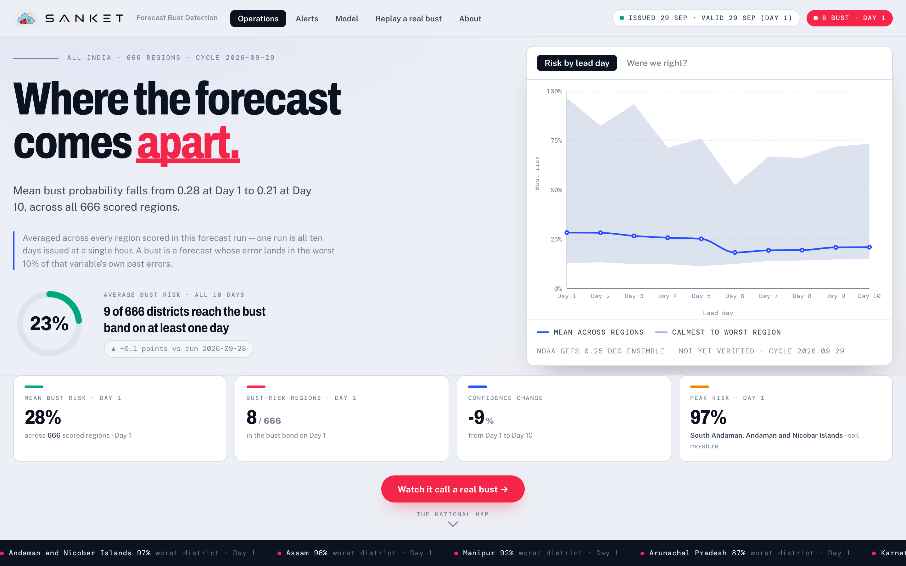

<div align="center">

  <picture>
    <source media="(prefers-color-scheme: dark)" srcset="docs/images/logo-dark.svg">
    
  </picture>

  <h3>Predicting where India's weather forecast may be wrong — and explaining why.</h3>

  **Smart India Hackathon 2026 · Problem Statement SIH26079 · Ministry of Earth Sciences**

  [](https://sanket-a0dd.onrender.com)
  [](https://youtu.be/rY73m6pxdpE)
  [](https://www.python.org/)
  [](https://react.dev/)
  [](LICENSE)

  **Maintained by Hrithik Roshan**

  [Live Demo](https://sanket-a0dd.onrender.com) · [API Docs](https://sanket-a0dd.onrender.com/docs) · [Demo Video](https://youtu.be/rY73m6pxdpE) · [Documentation](docs/README.md)

</div>



---

## Table of Contents

- [Overview](#overview)
- [Key Features](#key-features)
- [How It Works](#how-it-works)
- [System Architecture](#system-architecture)
- [Technology Stack](#technology-stack)
- [Getting Started](#getting-started)
- [Run on Windows](#run-on-windows)
- [Development Commands](#development-commands)
- [API Documentation](#api-documentation)
- [Deployment](#deployment)
- [Repository Structure](#repository-structure)
- [Data Sources and Attribution](#data-sources-and-attribution)
- [Limitations](#limitations)
- [Contributing](#contributing)
- [Credits](#credits)
- [License](#license)

## Overview

Sanket is a weather forecast bust-prediction and explainability platform for India. Instead of generating another weather forecast, it estimates how likely an existing forecast is to be significantly wrong and explains the factors contributing to that risk.

A **forecast bust** is defined using the historical error distribution of a weather variable. Sanket estimates bust probability for Indian districts, surface weather variables, and forecast lead days, helping users identify forecasts that may need additional attention.

The system is designed around three questions:

1. **Where is forecast risk high?** View bust probability across districts and forecast lead days.
2. **Why is the risk high?** Inspect model explanations and the factors influencing a prediction.
3. **What should be reviewed first?** Use risk-ranked alerts and historical event replay to investigate potentially unreliable forecasts.

## Key Features

- **District-level risk view:** Explore forecast bust probability across India's districts.
- **Explainable predictions:** View SHAP-based explanations for model predictions.
- **Forecast horizon:** Compare risk across lead days.
- **Risk-ranked alerts:** Find districts and forecast days with elevated risk.
- **Historical event replay:** Explore selected past weather events and review forecasts against observations.
- **Model information:** Inspect the served model, training information, evaluation metrics, and bust thresholds.
- **Data inspection:** Work with supported CSV and Parquet data through the application's ingestion workflow.

## How It Works

1. **Forecast data:** NOAA GEFS reforecast data is used for model development, with operational GEFS data used for current forecast cycles.
2. **Observation data:** ERA5 reanalysis and other documented observation sources are used for verification.
3. **District aggregation:** Gridded forecast and observation values are aggregated to district-level values using area-weighted geographic mapping.
4. **Feature engineering:** The pipeline builds features such as ensemble spread, forecast changes, pressure and moisture tendencies, seasonal information, and district characteristics.
5. **Machine learning:** XGBoost models estimate forecast error and bust probability. SHAP is used to explain model predictions.
6. **Dashboard serving:** FastAPI serves API responses and the built React dashboard.

## System Architecture

```text
        WEATHER DATA SOURCES
       NOAA GEFS / ERA5 / Other
                  |
                  v
          DATA INGESTION
       Parsing · Validation
       District aggregation
                  |
                  v
          CANONICAL DATA
        Parquet + SQLite
                  |
          +-------+-------+
          |               |
          v               v
     MODEL TRAINING    MODEL SERVING
     XGBoost / SHAP    FastAPI
          |               |
          v               v
     Model artifact   API responses
                          |
                          v
                   React Dashboard
```

The project separates model training from model serving. Training can require significantly more memory and compute than the lightweight serving process, so trained model artifacts and prepared responses are used by the deployed application.

## Technology Stack

| Layer | Technologies |
|---|---|
| Frontend | React 18, TypeScript, Vite |
| Backend | Python, FastAPI, Uvicorn |
| Machine Learning | XGBoost, scikit-learn, SHAP |
| Deep Learning challenger | PyTorch, ONNX |
| Data processing | pandas, NumPy, PyArrow |
| Storage | Parquet, SQLite, SQLAlchemy |
| Geospatial | Shapely, d3-geo, TopoJSON |
| Testing | pytest, httpx, Vitest |
| Deployment | Docker, Render, GitHub Actions |

## Getting Started

### Prerequisites

Install the following before running the project:

- Python **3.11 or 3.12**
- Node.js **18 or newer**
- npm
- Git

> Python 3.11 or 3.12 is recommended because the project's pinned dependencies are tested against these versions.

### 1. Clone the repository

```bash
git clone https://github.com/hrithik-roshan19/Sanket.git
cd Sanket
```

### 2. Set up the backend

```bash
cd backend

python -m venv .venv
```

Activate the virtual environment.

**macOS / Linux**
```bash
source .venv/bin/activate
```

**Windows PowerShell**
```powershell
.\.venv\Scripts\Activate.ps1
```

Install backend dependencies and create the local environment file:

```bash
python -m pip install --upgrade pip
pip install -r requirements.txt
```

**macOS / Linux**
```bash
cp .env.example .env
```

**Windows PowerShell**
```powershell
Copy-Item .env.example .env
```

### 3. Load the sample data and train the model

Run these commands from the `backend` directory:

```bash
python -m app.ingestion.pipeline --file data/samples/gefs_reforecast_india_2019.parquet --confirm-all

python -m app.ingestion.pipeline --file data/samples/era5_observations_india_2019.parquet --confirm-all
```

Enable local retraining and start the training pipeline.

**macOS / Linux**
```bash
ALLOW_LOCAL_RETRAIN=true python -m app.ml.train_pipeline
```

**Windows PowerShell**
```powershell
$env:ALLOW_LOCAL_RETRAIN = "true"
python -m app.ml.train_pipeline
```

### 4. Start the backend server

From the `backend` directory:

```bash
uvicorn app.main:app --reload --port 8000
```

Backend endpoints:

- API: `http://localhost:8000`
- Swagger documentation: `http://localhost:8000/docs`

Keep this terminal running.

### 5. Set up and start the frontend

Open a second terminal from the repository root:

```bash
cd frontend
npm install
```

Create the frontend environment file.

**macOS / Linux**
```bash
cp .env.example .env
```

**Windows PowerShell**
```powershell
Copy-Item .env.example .env
```

Start the Vite development server:

```bash
npm run dev
```

Open the local dashboard at:

**http://localhost:5173**

## Run on Windows

If you are using Windows PowerShell, the complete setup sequence is:

```powershell
# From the repository root
cd backend

py -3.12 -m venv .venv
.\.venv\Scripts\Activate.ps1

python -m pip install --upgrade pip
pip install -r requirements.txt
Copy-Item .env.example .env

python -m app.ingestion.pipeline --file data/samples/gefs_reforecast_india_2019.parquet --confirm-all
python -m app.ingestion.pipeline --file data/samples/era5_observations_india_2019.parquet --confirm-all

$env:ALLOW_LOCAL_RETRAIN = "true"
python -m app.ml.train_pipeline

uvicorn app.main:app --reload --port 8000
```

In a **second terminal**:

```powershell
cd frontend
npm install
Copy-Item .env.example .env
npm run dev
```

If PowerShell blocks virtual-environment activation, run:

```powershell
Set-ExecutionPolicy -Scope CurrentUser -ExecutionPolicy RemoteSigned
```

Then activate the environment again.

## Development Commands

Run backend commands from `backend/` and frontend commands from `frontend/`.

| Task | Command |
|---|---|
| Backend tests | `python -m pytest -q` |
| Frontend tests | `npm test` |
| Frontend lint | `npm run lint` |
| Frontend production build | `npm run build` |
| Local model training | `ALLOW_LOCAL_RETRAIN=true python -m app.ml.train_pipeline` |

For backend tests, install the development dependencies first:

```bash
pip install -r requirements-dev.txt
```

## API Documentation

When the backend is running, FastAPI provides interactive API documentation:

- Swagger UI: `http://localhost:8000/docs`
- OpenAPI schema: `http://localhost:8000/openapi.json`

For the hosted application, see the [live API documentation](https://sanket-a0dd.onrender.com/docs).

## Deployment

The project includes a Docker-based deployment configuration and a Render Blueprint (`render.yaml`). The intended production setup serves the API and built frontend from one service.

The upstream project documents a GitHub Actions refresh workflow for preparing model/data artifacts and triggering a Render deployment. Review the workflow files and deployment instructions in this repository before running a refresh:

- [Render configuration](render.yaml)
- [GitHub Actions workflows](.github/workflows/)
- [Deployment notes in the upstream project](https://github.com/Bhushan2318/sih-main#deployment)

**Important:** A fork or copied repository does not automatically own or control the existing hosted demo. The public demo link above points to the currently referenced hosted instance. To deploy your own instance, configure your own Render service, secrets, and model/data release artifacts as described in the deployment documentation.

## Repository Structure

```text
Sanket/
├── backend/
│   ├── app/
│   │   ├── api/          # API routers and response schemas
│   │   ├── db/           # Database models and operations
│   │   ├── features/     # Feature engineering
│   │   ├── ingestion/    # Data ingestion and validation
│   │   ├── live/         # Live weather data workflow
│   │   ├── ml/           # Machine learning and explanations
│   │   ├── realtime/     # Real-time events
│   │   ├── services/     # Application services
│   │   ├── storage/      # Parquet storage
│   │   └── main.py       # FastAPI application
│   ├── data/
│   ├── scripts/
│   └── tests/
├── frontend/
│   └── src/
│       ├── api/
│       ├── components/
│       ├── hooks/
│       ├── pages/
│       └── styles.css
├── docs/
├── .github/
├── Dockerfile
├── render.yaml
├── LICENSE
└── README.md
```

## Data Sources and Attribution

The project documentation identifies the following data sources:

- [NOAA GEFSv12 reforecast](https://registry.opendata.aws/noaa-gefs-reforecast/)
- [NOAA GEFS operational forecast](https://www.nco.ncep.noaa.gov/pmb/products/gens/)
- [ERA5 / Copernicus Climate Change Service](https://cds.climate.copernicus.eu/)
- [Open-Meteo](https://open-meteo.com/)
- [GADM](https://gadm.org/)
- [Natural Earth](https://www.naturalearthdata.com/)
- [India Meteorological Department](https://mausam.imd.gov.in/)
- [NASA POWER](https://power.larc.nasa.gov/)

Each dataset and third-party asset has its own terms. Review `THIRD_PARTY_NOTICES.md`, `THIRD_PARTY_LICENSES.txt`, `REUSE.toml`, and the `LICENSES/` directory before reusing or redistributing project materials. In particular, check GADM's terms before using its boundary data commercially.

## Limitations

- The quality of model evaluation depends on the available held-out years and observation datasets.
- Some weather variables have shorter training coverage than others.
- The GEFS reforecast archive has fewer ensemble members than the full operational ensemble.
- ERA5 precipitation has known limitations over India compared with gauge-based gridded products.
- Observations and reanalysis products have their own uncertainty; forecast bust labels are not perfect ground truth.
- The deployed free-tier serving instance is designed for inference and serving prepared responses, not heavy model training.

See [known issues](docs/known-issues.md) for the project's documented caveats and ongoing work.

## Contributing

Contributions, bug reports, and suggestions are welcome. Before making changes, please read:

- [Contributing guidelines](CONTRIBUTING.md)
- [Code of Conduct](CODE_OF_CONDUCT.md)
- [Security policy](SECURITY.md)

Please avoid committing credentials, `.env` files, virtual environments, `node_modules`, generated databases, or large local model/data files unless the repository explicitly requires them.

## Credits

This repository is maintained by **Hrithik Roshan**.

## License

The project's own work is released under the [MIT License](LICENSE), subject to the separate licenses and terms that apply to third-party datasets, libraries, fonts, images, and other assets. Review the included license and attribution files before reuse.
